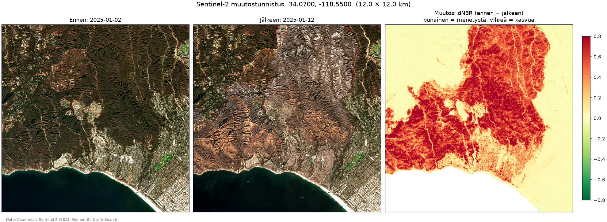

# sentinel-change

> Change detection from free Sentinel-2 satellite imagery: give a point and two dates, get a before/after comparison and a burn-severity (dNBR) or vegetation-loss (dNDVI) map. No account or API key needed.

Muutostunnistus ilmaisista Sentinel-2-satelliittikuvista. Annat pisteen ja kaksi päivämäärää, ja skripti tekee vertailukuvan ennen ja jälkeen sekä muutoskartan.



*Palisades-palo (Los Angeles, 7.1.2025). Vasemmalla 2.1., keskellä 12.1., oikealla dNBR: mitä punaisempi, sitä voimakkaammin palanut. Meri on rajattu pois.*

## Mitä se tekee

1. **Hakee kuvat** kummankin päivämäärän ympäriltä [Element84 Earth Search](https://element84.com/earth-search/) -STAC-katalogista (Sentinel-2 L2A, ilmainen, ei tiliä).
2. **Valitsee vähiten pilvisen kuvan** tarkistamalla juuri tutkittavan alueen kuvan omasta luokittelukerroksesta (SCL). Koko 110 × 110 km tiilen pilvisyysprosentti ei kerro paljoa yhdestä pienestä alueesta.
3. **Lukee vain tarvittavan alueen** suoraan pilvestä. Kuvat ovat Cloud Optimized GeoTIFF -muodossa, joten koko satojen megatavujen tiiltä ei ladata.
4. **Kohdistaa kaikki kanavat ja molemmat päivät** samaan 10 m:n UTM-ruudukkoon, jolloin pikselit vastaavat toisiaan.
5. **Laskee indeksin ja erotuksen**, ja peittää pilvet, varjot ja veden.
6. **Tallentaa** vertailukuvan (PNG), erotuskartan (GeoTIFF, avautuu oikeaan paikkaan esim. QGIS:ssä) ja tekstiyhteenvedon.

## Indeksit

| Indeksi | Kaava | Käyttö | Tulkinta erotukselle (ennen − jälkeen) |
|---|---|---|---|
| `nbr` | (NIR − SWIR2) / (NIR + SWIR2) | Paloalueet | dNBR ≥ 0,27 → palanut ([USGS-luokitus](https://www.usgs.gov/), Key & Benson 2006) |
| `ndvi` | (NIR − Red) / (NIR + Red) | Kasvillisuuden muutokset | dNDVI > 0,2 → kasvillisuus vähentynyt |

## Asennus (Linux / WSL)

```bash
bash setup.sh
source ~/.venvs/sentinel-change/bin/activate
```

`setup.sh` luo virtuaaliympäristön kotihakemistoon ja asentaa `requirements.txt`:n paketit (`pystac-client`, `rasterio`, `numpy`, `matplotlib`).

## Käyttö

```bash
python3 sentinel_change.py --lat 34.07 --lon -118.55 \
    --before 2024-12-28 --after 2025-01-20 --size-km 12 --index nbr
```

| Valinta | Oletus | Selitys |
|---|---|---|
| `--lat`, `--lon` | – | Alueen keskipiste |
| `--before`, `--after` | – | Päivämäärät `YYYY-MM-DD` |
| `--size-km` | 5 | Neliön sivun pituus (0,5–50 km) |
| `--index` | `nbr` | `nbr` tai `ndvi` |
| `--window` | 10 | Kuvia haetaan päivämäärän ± näin monen päivän sisältä |
| `--candidates` | 6 | Montako kuvaa tarkistetaan pilvien varalta per päivä |
| `--out` | `tulokset` | Tuloskansio |

## Rajoitukset

- **Tarkkuus on 10 m.** Rakennusryhmät, tiet ja isot alukset näkyvät, yksittäiset autot tai pienet rakennukset eivät.
- **Pilvet ja savu:** SCL tunnistaa paksun savun usein pilveksi. Palon aikana otetut kuvat hylätään siksi yleensä automaattisesti.
- **Vuodenajat:** kasvillisuus muuttuu luonnostaan. Vertaa mieluiten saman vuodenajan kuvia tai lähellä toisiaan olevia päiviä.
- **Indeksi kertoo muutoksesta, ei sen syystä.** Tarkista tulkinta aina muista lähteistä.

## Tekninen huomio: kaksinkertainen offset

Earth Search -kuvissa on jo valmiiksi lisätty Sentinel-2:n −0,1 BOA-offset (`earthsearch:boa_offset_applied: true`), mutta kanavien metadatassa offset on silti mukana. Jos metadatan offset lisätään vielä kerran, tummat pinnat menevät negatiivisiksi ja NDVI/NBR vääristyvät. Skripti tarkistaa tämän (`read_band`).

## Lisenssi

Koodi: MIT. Satelliittidata: [Copernicus Sentinel -data](https://sentinels.copernicus.eu/), sisältää muokattua Copernicus Sentinel -dataa.
